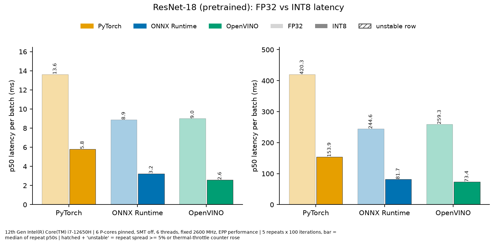
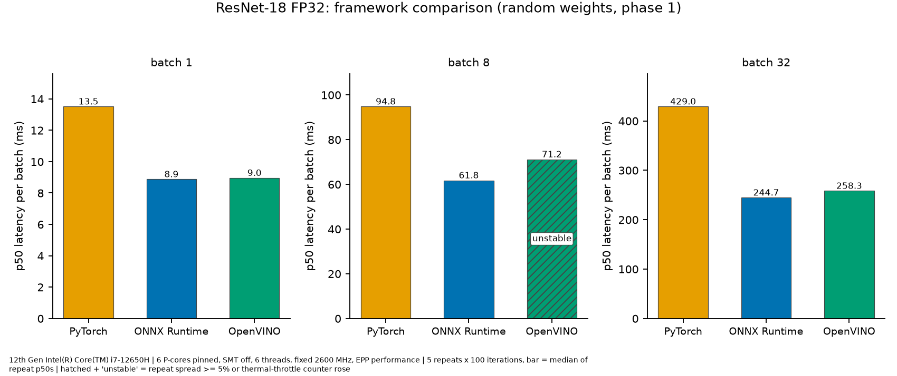
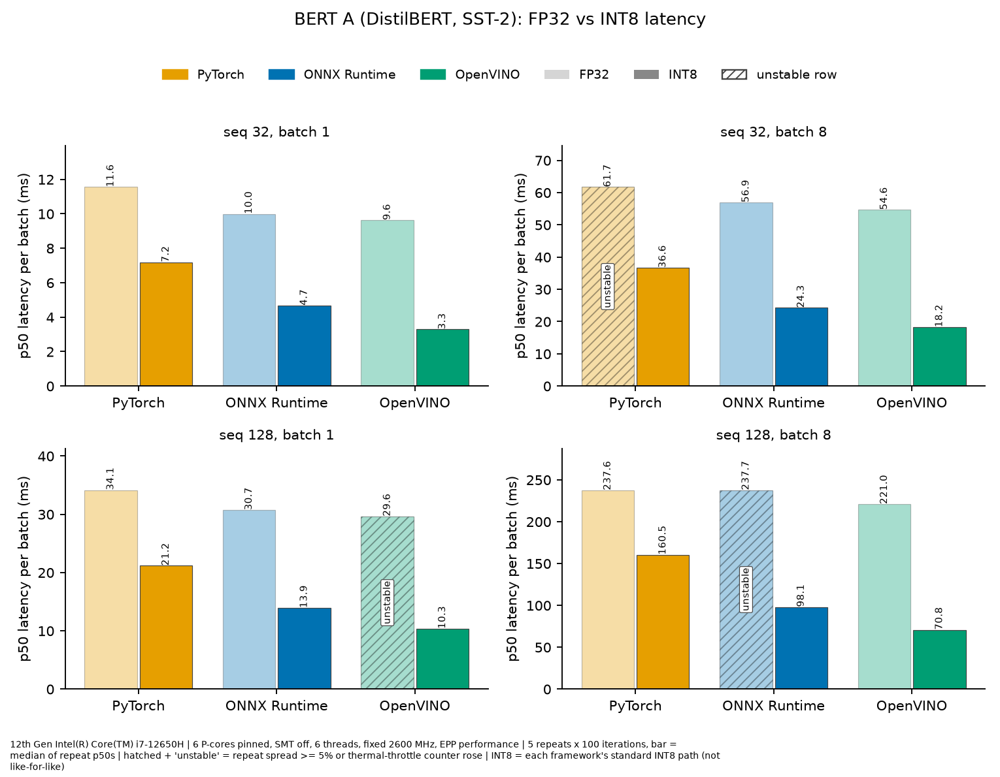
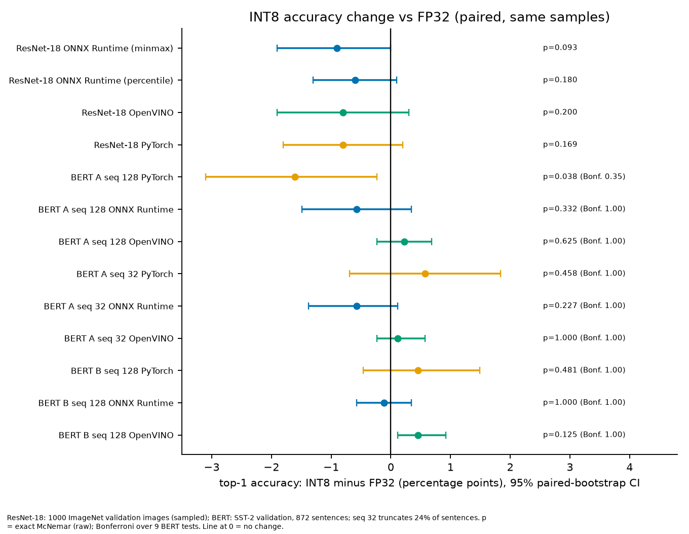

## Problem
Framework comparisons on a laptop CPU are easy to get wrong: power and thermal limits move the clock during a run. I wanted INT8 vs FP32 numbers for PyTorch, ONNX Runtime and OpenVINO that I could trust and reproduce.

## What I did
Benchmarked ResNet-18 and two small SST-2 BERT-family models (DistilBERT and BERT-mini) on an Intel i7-12650H, using only the 6 P-cores pinned at a fixed 2.6 GHz. I applied INT8 post-training quantization (static and dynamic) with ONNX Runtime, OpenVINO NNCF and PyTorch, and profiled with `torch.profiler`, ONNX Runtime profiling and OpenVINO `PERF_COUNT`. The scope is inference, quantization and profiling, not training.

## Method
My first, uncontrolled attempt was invalid: 12 of 18 repeated rows differed by more than 5% between two identical runs. A pilot at 3000 MHz still raised thermal-throttle counters in 2 of 4 rows. The reported runs use a fixed clock, pinned cores, a cooldown before every repeat and a stability rule: a row counts as stable only if its spread is below 5% and no throttle counter increased. Ratios are printed only between stable rows. Accuracy changes use a paired bootstrap and the McNemar test, with a Bonferroni correction for the BERT comparisons.

## Results
- ResNet-18, INT8 vs FP32 at batch 1: PyTorch **2.34×**, ONNX Runtime **2.74×**, OpenVINO **3.48×**. OpenVINO INT8 reaches **2.6 ms** per image.
- ResNet-18 top-1 change: −0.6 to −0.9 points, not statistically significant on 1000 images.
- DistilBERT and BERT-mini (SST-2): INT8 was **1.10–3.12×** faster. Accuracy differences are not significant after Bonferroni correction.

<figure class="chart-fig">
<svg class="chart" viewBox="0 0 360 214" role="img" aria-label="ResNet-18, INT8 speedup over FP32, batch 1 (higher is better): PyTorch 2.34×; ONNX Runtime 2.74×; OpenVINO 3.48×">
<text class="c-label" x="0" y="16">PyTorch</text>
<rect class="c-bar" x="0" y="24" width="180.5" height="26" rx="4"/>
<text class="c-val" x="188.5" y="43">2.34×</text>
<text class="c-label" x="0" y="78">ONNX Runtime</text>
<rect class="c-bar" x="0" y="86" width="211.4" height="26" rx="4"/>
<text class="c-val" x="219.4" y="105">2.74×</text>
<text class="c-label" x="0" y="140">OpenVINO</text>
<rect class="c-bar" x="0" y="148" width="268.5" height="26" rx="4"/>
<text class="c-val" x="276.5" y="167">3.48×</text>
<line class="c-base" x1="77.1" y1="20" x2="77.1" y2="186"/>
<text class="c-note" x="83.1" y="206">FP32 = 1×</text>
</svg>
<figcaption>ResNet-18, INT8 speedup over FP32, batch 1 (higher is better)</figcaption>
</figure>

## Figures
Figures from the repository README; the text inside the images is in English.

*ResNet-18, FP32 vs INT8, p50 latency per batch (ms). Left: batch 1. Right: batch 32.*

*ResNet-18 FP32, framework comparison (random weights, phase 1): p50 latency per batch at batch 1, 8 and 32. The hatched OpenVINO bar at batch 8 is an unstable row.*

*BERT A (DistilBERT, SST-2), FP32 vs INT8, p50 latency per batch: sequence length 32 and 128, batch 1 and 8. Hatched bars are unstable rows.*

*INT8 accuracy change vs FP32 (paired, same samples): top-1 difference in percentage points with 95% paired-bootstrap confidence intervals. p-values are exact McNemar; the BERT rows also show the Bonferroni-corrected value.*

## Limitations
- Each framework's standard INT8 path is compared, not identical quantization. In BERT, for example, OpenVINO also quantizes the attention MatMuls.
- I did not verify the cause of the speedup (for example VNNI). Kernel names do not settle it.
- One laptop, one CPU, 2.6 GHz sustained rather than peak clock. ResNet-18 accuracy uses a 1000-image sample.
- A VPN client was running during all runs; its effect was not measured.

## AI assistance
Code written with Claude Code; methodology, decisions and verification are mine.
