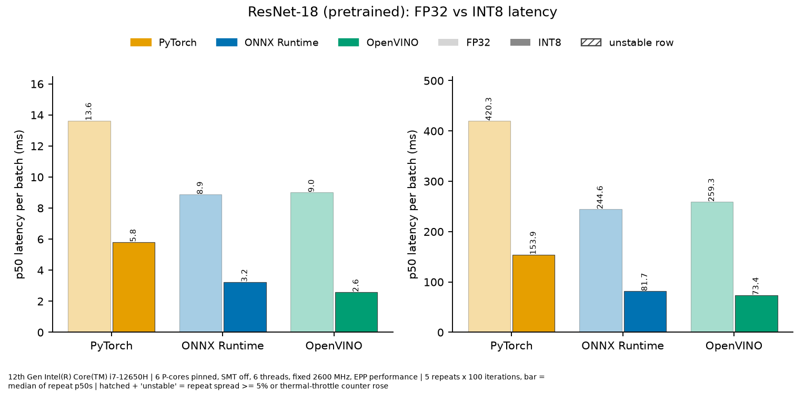
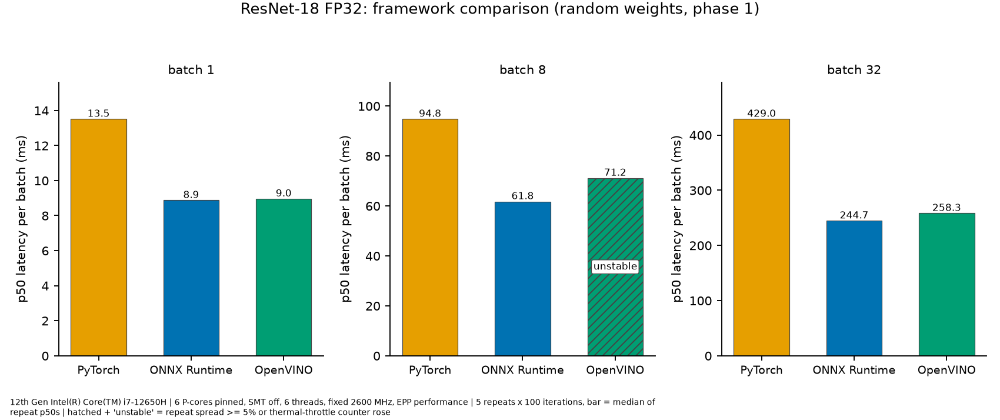
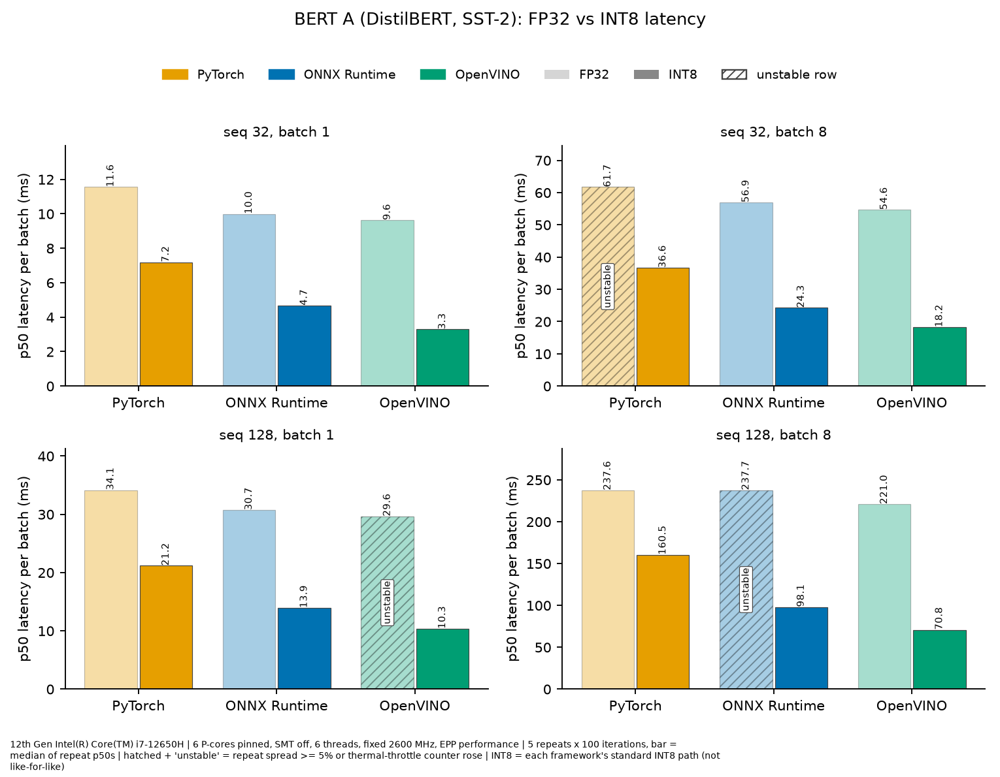
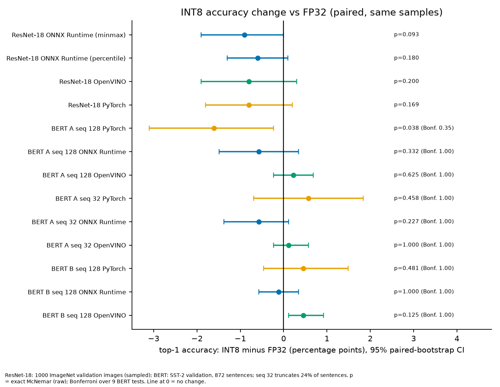

## Задача
Сравнивать фреймворки на ноутбучном CPU легко неправильно: ограничения по мощности и температуре меняют частоту прямо во время замеров. Мне нужны были цифры INT8 и FP32 для PyTorch, ONNX Runtime и OpenVINO, которым можно доверять и которые можно воспроизвести.

## Что я сделал
Измерил ResNet-18 и две небольшие BERT-подобные модели для SST-2 (DistilBERT и BERT-mini) на Intel i7-12650H, используя только 6 P-ядер с фиксированной частотой 2,6 ГГц. Применил INT8 post-training quantization (статическую и динамическую) в ONNX Runtime, OpenVINO NNCF и PyTorch и провёл профилирование через `torch.profiler`, профилирование ONNX Runtime и OpenVINO `PERF_COUNT`. Область работы: инференс, квантизация и профилирование, а не обучение.

## Методика
Первая, неконтролируемая попытка оказалась непригодной: у 12 из 18 повторных строк два одинаковых запуска отличались более чем на 5%. Пилот на 3000 МГц всё равно увеличил счётчики термического троттлинга в 2 из 4 строк. В итоговых запусках частота фиксирована, ядра закреплены, перед каждым повтором есть охлаждение, а строка считается стабильной, только если разброс ниже 5% и счётчики троттлинга не выросли. Ускорение указано только между стабильными строками. Изменение точности оценивается парным бутстрэпом и критерием Мак-Немара, для BERT добавлена поправка Бонферрони.

## Результаты
- ResNet-18, batch 1, INT8 против FP32: PyTorch **2,34×**, ONNX Runtime **2,74×**, OpenVINO **3,48×**. OpenVINO INT8 — **2,6 мс** на изображение.
- Изменение top-1 для ResNet-18: от −0,6 до −0,9 п.п., статистически незначимо на 1000 изображениях.
- DistilBERT и BERT-mini (SST-2): INT8 быстрее в **1,10–3,12×**. Различия в точности незначимы после поправки Бонферрони.

<figure class="chart-fig">
<svg class="chart" viewBox="0 0 360 214" role="img" aria-label="ResNet-18, batch 1, ускорение INT8 относительно FP32 (больше — лучше): PyTorch 2,34×; ONNX Runtime 2,74×; OpenVINO 3,48×">
<text class="c-label" x="0" y="16">PyTorch</text>
<rect class="c-bar" x="0" y="24" width="180.5" height="26" rx="4"/>
<text class="c-val" x="188.5" y="43">2,34×</text>
<text class="c-label" x="0" y="78">ONNX Runtime</text>
<rect class="c-bar" x="0" y="86" width="211.4" height="26" rx="4"/>
<text class="c-val" x="219.4" y="105">2,74×</text>
<text class="c-label" x="0" y="140">OpenVINO</text>
<rect class="c-bar" x="0" y="148" width="268.5" height="26" rx="4"/>
<text class="c-val" x="276.5" y="167">3,48×</text>
<line class="c-base" x1="77.1" y1="20" x2="77.1" y2="186"/>
<text class="c-note" x="83.1" y="206">FP32 = 1×</text>
</svg>
<figcaption>ResNet-18, batch 1, ускорение INT8 относительно FP32 (больше — лучше)</figcaption>
</figure>

## Графики
Графики из README репозитория; текст на изображениях на английском.

*ResNet-18, FP32 и INT8, p50-задержка на батч (мс). Слева: batch 1, справа: batch 32.*

*ResNet-18 FP32, сравнение фреймворков (случайные веса, фаза 1): p50-задержка на батч при batch 1, 8 и 32. Штрихованный столбец OpenVINO при batch 8 — нестабильная строка.*

*BERT A (DistilBERT, SST-2), FP32 и INT8, p50-задержка на батч: длина последовательности 32 и 128, batch 1 и 8. Штрихованные столбцы — нестабильные строки.*

*Изменение точности INT8 относительно FP32 (парное, на тех же выборках): разница top-1 в процентных пунктах с 95% доверительными интервалами парного бутстрэпа. p-значения — точный критерий Мак-Немара; для строк BERT дано и значение с поправкой Бонферрони.*

## Ограничения
- Сравниваются стандартные INT8-пути каждого фреймворка, а не идентичная квантизация. Например, в BERT OpenVINO дополнительно квантизует MatMul в блоках внимания.
- Причину ускорения (например, VNNI) я не проверял; по названиям ядер это не определить.
- Один ноутбук, один CPU, устойчивая частота 2,6 ГГц, а не пиковая. Точность ResNet-18 измерена на выборке из 1000 изображений.
- Во время всех запусков работал VPN-клиент; его влияние не измерялось.

## Участие ИИ
Код написан с помощью Claude Code; методология, решения и проверка результатов — мои.
