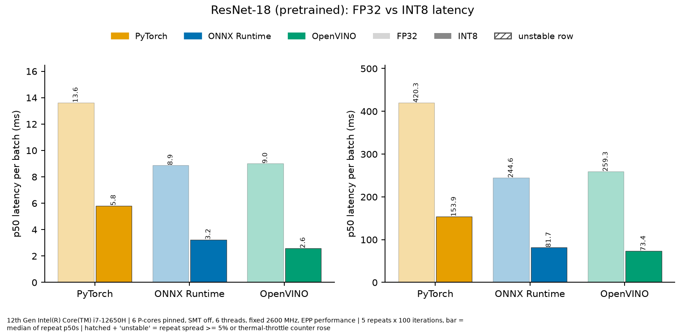
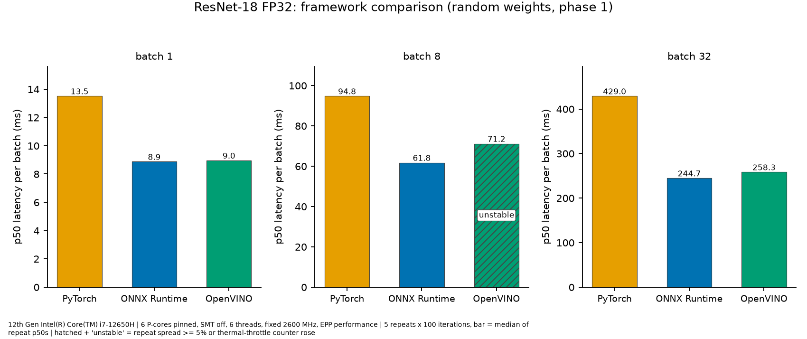
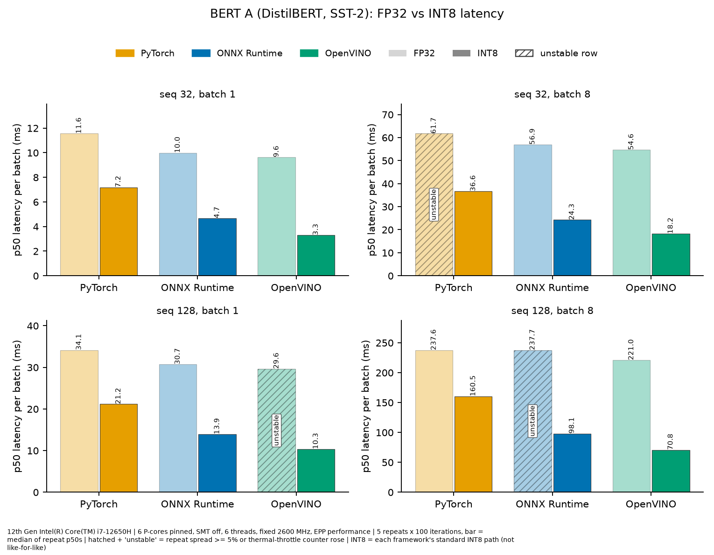
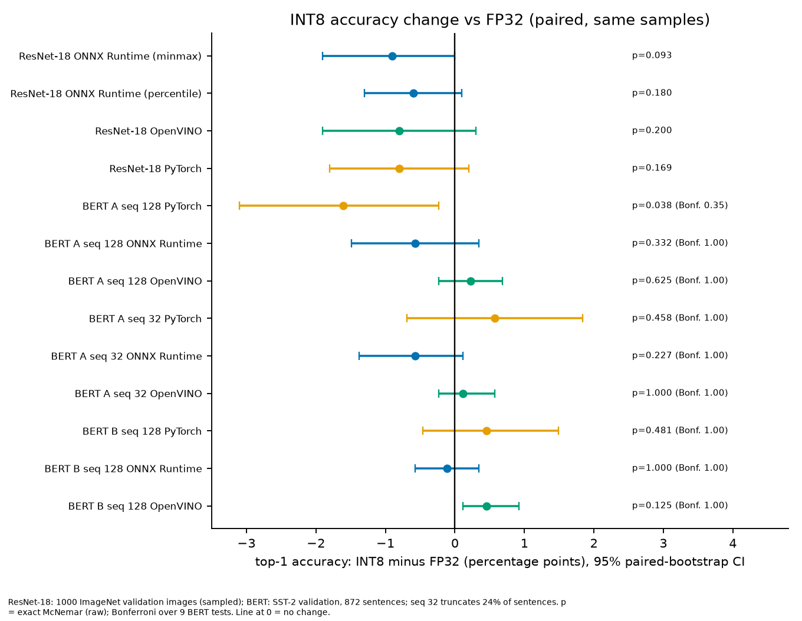

<!-- REVIEW: translation -->
## 问题
在笔记本 CPU 上比较框架很容易出错：功耗与温度限制会在运行过程中改变频率。我想得到 PyTorch、ONNX Runtime 和 OpenVINO 的 INT8 与 FP32 对比数据，并且这些数据可信、可复现。

## 我做了什么
在 Intel i7-12650H 上对 ResNet-18 和两个小型 SST-2 BERT 系列模型（DistilBERT 与 BERT-mini）做基准测试，只使用 6 个 P 核，绑定核心并将频率固定在 2.6 GHz。我用 ONNX Runtime、OpenVINO NNCF 和 PyTorch 做了 INT8 训练后量化（静态和动态），并用 `torch.profiler`、ONNX Runtime profiling 和 OpenVINO `PERF_COUNT` 做性能分析。范围是推理、量化与性能分析，不包括训练。

## 方法
我第一次不受控的尝试是无效的：18 组重复测量中有 12 组，两次相同运行之间的差异超过 5%。在 3000 MHz 下的试运行中，4 组里仍有 2 组触发了热降频计数器。正式结果使用固定频率、绑定核心、每次重复前的冷却等待，以及一条稳定性规则：只有波动低于 5% 且热降频计数器没有增加时，该组才算稳定。只在稳定的组之间给出加速比。精度变化使用配对 bootstrap 与 McNemar 检验，BERT 的比较使用 Bonferroni 校正。

## 结果
- ResNet-18，batch 1，INT8 对 FP32：PyTorch **2.34×**，ONNX Runtime **2.74×**，OpenVINO **3.48×**。OpenVINO INT8 每张图像 **2.6 ms**。
- ResNet-18 top-1 变化：−0.6 至 −0.9 个百分点，在 1000 张图像上不具统计显著性。
- DistilBERT 与 BERT-mini（SST-2）：INT8 快 **1.10–3.12×**。经 Bonferroni 校正后，精度差异不显著。

<figure class="chart-fig">
<svg class="chart" viewBox="0 0 360 214" role="img" aria-label="ResNet-18，batch 1，INT8 相对 FP32 的加速比（越高越好）: PyTorch 2.34×; ONNX Runtime 2.74×; OpenVINO 3.48×">
<text class="c-label" x="0" y="16">PyTorch</text>
<rect class="c-bar" x="0" y="24" width="180.5" height="26" rx="4"/>
<text class="c-val" x="188.5" y="43">2.34×</text>
<text class="c-label" x="0" y="78">ONNX Runtime</text>
<rect class="c-bar" x="0" y="86" width="211.4" height="26" rx="4"/>
<text class="c-val" x="219.4" y="105">2.74×</text>
<text class="c-label" x="0" y="140">OpenVINO</text>
<rect class="c-bar" x="0" y="148" width="268.5" height="26" rx="4"/>
<text class="c-val" x="276.5" y="167">3.48×</text>
<line class="c-base" x1="77.1" y1="20" x2="77.1" y2="186"/>
<text class="c-note" x="83.1" y="206">FP32 = 1×</text>
</svg>
<figcaption>ResNet-18，batch 1，INT8 相对 FP32 的加速比（越高越好）</figcaption>
</figure>

## 图表
以下图表来自仓库 README；图中文字为英文。

*ResNet-18，FP32 与 INT8，每批 p50 延迟（ms）。左：batch 1；右：batch 32。*

*ResNet-18 FP32 框架对比（随机权重，第 1 阶段）：batch 1、8、32 的每批 p50 延迟。batch 8 下带斜线的 OpenVINO 柱为不稳定行。*

*BERT A（DistilBERT，SST-2），FP32 与 INT8，每批 p50 延迟：序列长度 32 和 128，batch 1 和 8。带斜线的柱为不稳定行。*

*INT8 相对 FP32 的精度变化（配对，同一样本）：top-1 差值（百分点）及 95% 配对 bootstrap 置信区间。p 值为精确 McNemar 检验；BERT 各行同时给出 Bonferroni 校正值。*

## 局限
- 比较的是各框架标准的 INT8 路径，而不是完全相同的量化方式。例如在 BERT 中，OpenVINO 还会量化注意力部分的 MatMul。
- 我没有验证加速的原因（例如 VNNI），仅凭内核名称无法确定。
- 只用了一台笔记本、一颗 CPU，频率为持续 2.6 GHz 而非峰值频率。ResNet-18 精度使用 1000 张图像的样本。
- 所有运行期间都开着 VPN 客户端，其影响未测量。

## AI 辅助说明
代码由 Claude Code 编写；方法设计、决策与结果验证由我本人完成。
