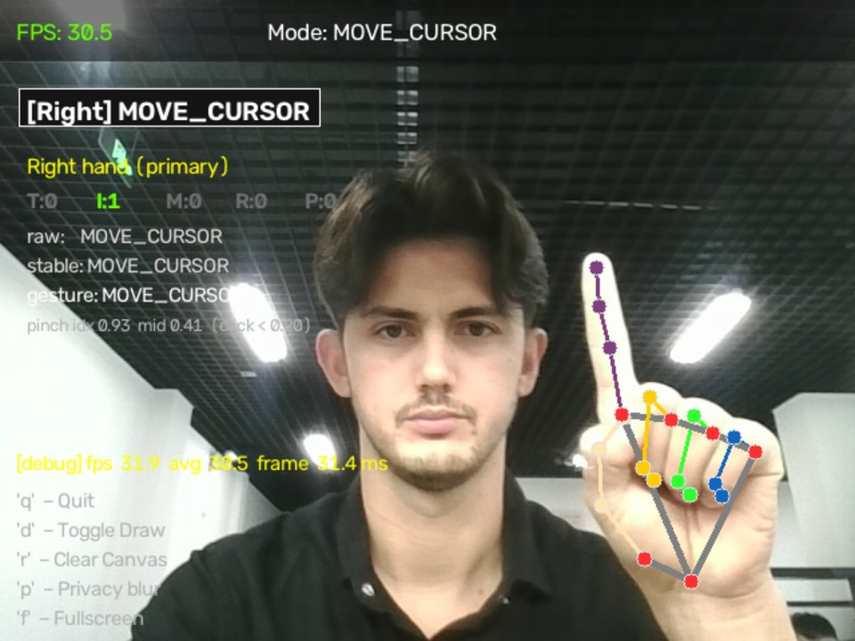

<!-- REVIEW: translation -->
## Задача
Управлять компьютером (клики, прокрутка, громкость, скриншоты) жестами руки с обычной веб-камеры, только на CPU, в том числе в Linux/Wayland, где распространённые библиотеки ввода не работают.

## Что я сделал
Собрал конвейер реального времени на MediaPipe и OpenCV и движок жестов, который устраняет дребезг поз, чтобы сбои детектора не вызывали действий. В Wayland ввод эмулируется виртуальным указателем через `uinput`. В проекте есть CI.

## Методика
Частота кадров измерялась скриптом бенчмарка (реальная веб-камера и MediaPipe, без окна и без эмуляции ввода) на машине без GPU. Тесты работают на синтетических ключевых точках руки, поэтому камера им не нужна.

## Результаты
- **29,9 FPS** для связки камера + трекинг при руке в кадре (предел камеры около 30 FPS), против 16,5–21,6 FPS при первых настройках.
- **228 тестов** за около 1,6 с.

## Медиа
Скриншот и демонстрация из README репозитория; текст на экране на английском.

*Режим `--debug`: FPS, время кадра, состояния пальцев, исходный → стабильный → жест.*

<figure class="video-fig">
<video controls preload="none" playsinline width="800" height="450" poster="/media/gesture-demo-poster.webp" aria-label="Демонстрация Gesture Control: курсор, двойной щелчок, прокрутка, громкость, скриншот">
<source src="/media/gesture-demo.mp4" type="video/mp4">
</video>
<figcaption>Демонстрация: курсор, двойной щелчок, прокрутка, громкость, скриншот. Видео, 20 с, без звука.</figcaption>
</figure>

## Ограничения
- Точность распознавания не измерена.
- Полное приложение (окно, оверлей, эмуляция ввода) не тестировалось по производительности — только камера плюс трекинг.

## Участие ИИ
Код написан с помощью Claude Code; методология, решения и проверка результатов — мои.
