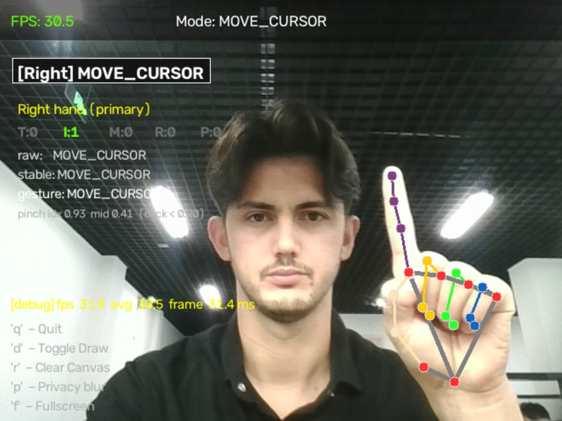

## Muammo
Kompyuterni (bosish, aylantirish, ovoz, skrinshotlar) oddiy veb-kamera orqali qo‘l imo-ishoralari bilan, faqat CPU’da boshqarish; shu jumladan keng tarqalgan kiritish kutubxonalari ishlamaydigan Linux/Wayland’da ham.

## Nima qildim
MediaPipe qo‘l kuzatuvi va OpenCV asosida real vaqt konveyerini qurdim, shuningdek, pozalarni debounce qiladigan imo-ishora mexanizmini yozdim, shunda detektor miltillashi harakatlarni ishga tushira olmaydi. Wayland’da kiritish `uinput` orqali virtual ko‘rsatkich yordamida amalga oshiriladi. Loyihada CI bor.

## Metod
Kadr tezligi benchmark skripti bilan (haqiqiy veb-kamera va MediaPipe, oynasiz, kiritishni yuborishsiz) faqat CPU’li mashinada o‘lchandi. Testlar sintetik qo‘l landmarklarida ishlaydi, shuning uchun kamera kerak emas.

## Natijalar
- Qo‘l ko‘rinib turganda kamera va kuzatuv uchun **29.9 FPS** (kamera chegarasi taxminan 30 FPS); dastlabki sozlamalarda bu 16.5–21.6 FPS edi.
- Taxminan 1.6 s ichida **228 ta test**.

## Media
Skrinshot va demo repozitoriy README’sidan; ekrandagi matn inglizcha.

*`--debug` rejimi: FPS, kadr vaqti, barmoq holatlari, xom → barqaror → imo-ishora.*

<figure class="video-fig">
<video controls preload="none" playsinline width="800" height="450" poster="/media/gesture-demo-poster.webp" aria-label="Gesture Control demosi: kursor, ikki marta bosish, aylantirish, ovoz, skrinshot">
<source src="/media/gesture-demo.mp4" type="video/mp4">
</video>
<figcaption>Demo: kursor, ikki marta bosish, aylantirish, ovoz, skrinshot. Video, 20 s, ovozsiz.</figcaption>
</figure>

## Cheklovlar
- Tanib olish aniqligi o‘lchanmagan.
- To‘liq ilova (oyna, overlay, kiritishni yuborish) benchmark qilinmagan, faqat kamera va kuzatuv.

## AI yordami
Kod Claude Code yordamida yozilgan; metodologiya, qarorlar va tekshiruv menga tegishli.
