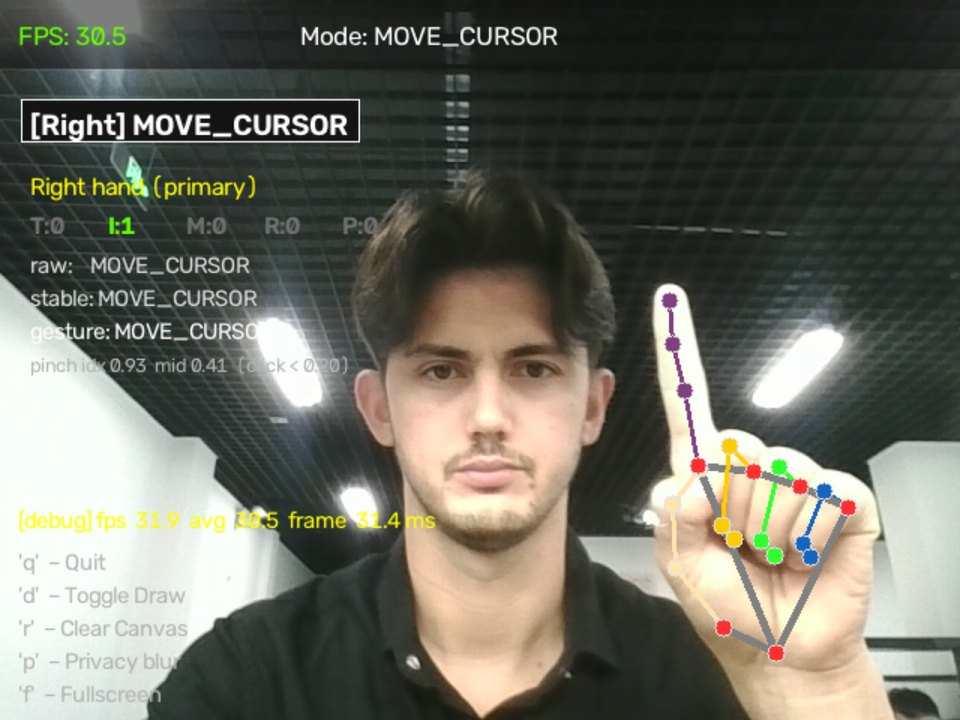

## 问题
用普通摄像头和手势控制电脑（点击、滚动、音量、截图），只使用 CPU，并且在常见输入库无法工作的 Linux/Wayland 上也能运行。

## 我做了什么
用 MediaPipe 手部追踪和 OpenCV 构建了实时流程，并实现了手势引擎，对姿势做去抖处理，避免检测器抖动误触发操作。在 Wayland 上，通过 `uinput` 的虚拟指针注入输入。项目包含 CI。

## 方法
用基准脚本（真实摄像头与 MediaPipe，无窗口、无输入注入）在仅使用 CPU 的机器上测量帧率。测试使用合成的手部关键点，因此不需要摄像头。

## 结果
- 画面中有手时，摄像头加追踪达到 **29.9 FPS**（摄像头上限约 30 FPS），初始设置下为 16.5–21.6 FPS。
- **228 个测试**，约 1.6 秒。

## 截图与演示
截图与演示来自仓库 README；画面中的文字为英文。

*`--debug` 模式：FPS、帧时间、手指状态、原始 → 稳定 → 手势。*

<figure class="video-fig">
<video controls preload="none" playsinline width="800" height="450" poster="/media/gesture-demo-poster.webp" aria-label="Gesture Control 演示：光标、双击、滚动、音量、截图">
<source src="/media/gesture-demo.mp4" type="video/mp4">
</video>
<figcaption>演示：光标、双击、滚动、音量、截图。视频，20 秒，无声音。</figcaption>
</figure>

## 局限
- 识别准确率尚未测量。
- 完整应用（窗口、叠加显示、输入注入）没有做基准测试，只测了摄像头加追踪。

## AI 辅助说明
代码由 Claude Code 编写；方法设计、决策与结果验证由我本人完成。
