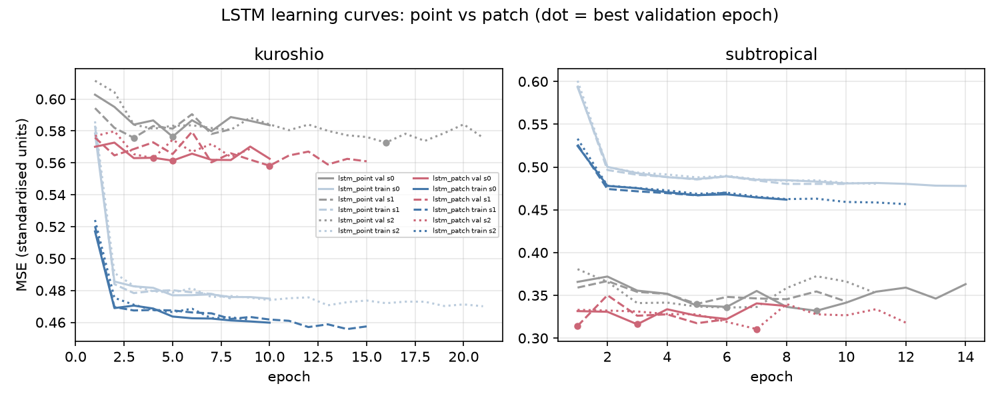
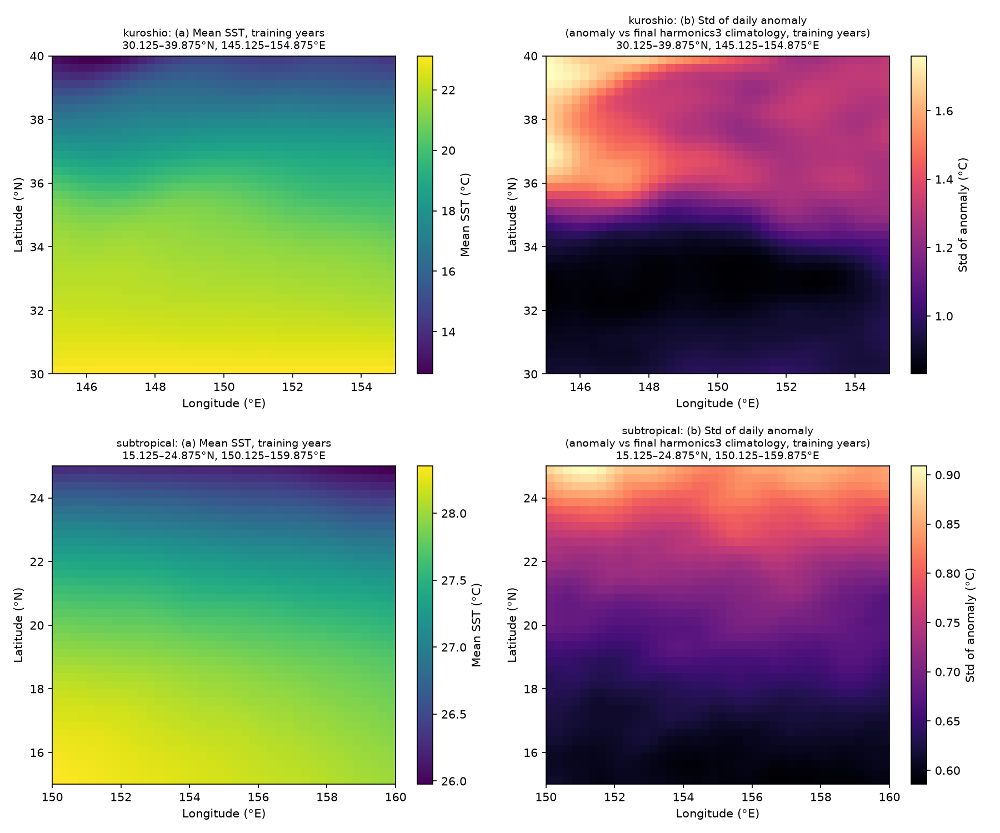
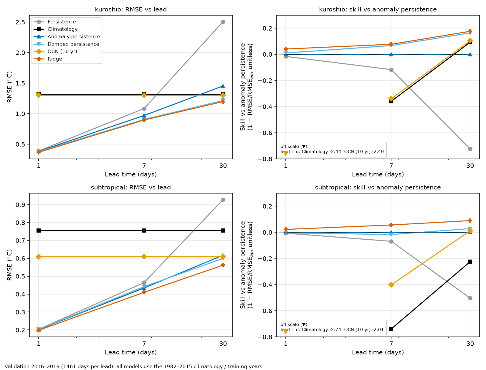
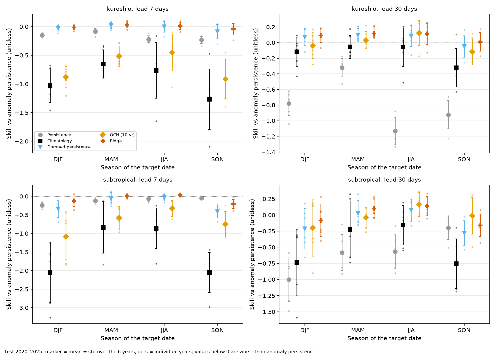
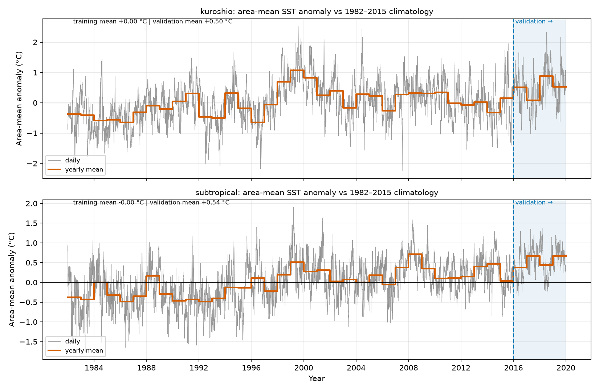
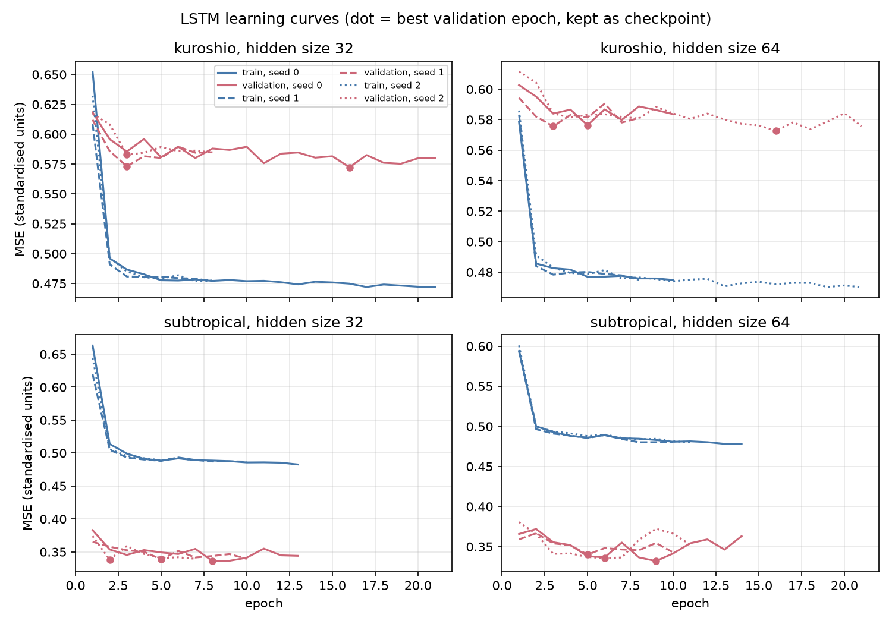

## Problem
Before comparing any learned model on sea surface temperature (SST), you need to know how hard simple baselines are to beat. This is a study of those baselines, not a model for operational ocean forecasts. The work was done with the permission of my teacher at HEU.

## What I did
Built the data pipeline and evaluation for NOAA OISST v2.1 daily SST in two Pacific regions (Kuroshio and subtropical), 1982–2025. ERDDAP was missing 1,194 days per region, which I filled from NOAA PSL with verification checks. I compared six baselines: persistence, fixed smoothed climatology, anomaly persistence, damped persistence, a 10-year daily climatology (OCN) and per-grid-point Ridge regression. The project has 79 tests and CI.

## Method
Fixed split: 1982–2015 for training, 2016–2019 for validation, 2020–2025 for test. The test set was run once, after the configuration was frozen and tagged in git.

Afterwards I added a small LSTM experiment. It uses the same information as Ridge (the last 30 days of anomaly at one grid point), with 1 layer and hidden size 64 chosen on validation, and 3 seeds per region. Its protocol was written and tagged `pre-lstm-test` before the test years were loaded, and the test was run once (2026-11-05). Results are mean over seeds, with no seed picking.

## Results
Methods that pull toward climatology (damped persistence and Ridge) lost most of their validation advantage in the test years. This is consistent with a larger warm shift in the test period, but the cause is not proven.

> “Good job.”
>
> — Associate Professor Green, on the baseline results

The small LSTM beat Ridge in the subtropical box and did not beat it in the Kuroshio box. Skill vs Ridge at 1, 7 and 30 days on test: subtropical +0.029, +0.025, +0.022; Kuroshio −0.061, −0.017, −0.001. On validation the Kuroshio 7- and 30-day numbers had been slightly positive, and those gains did not hold. The subtropical result is weaker than it looks: Ridge is itself behind anomaly persistence at 1 and 7 days there, and so is the LSTM. The two regions disagree, so I make no general claim.

## Spatial context (B1)
Afterwards I asked whether neighbouring grid points help, and how much of an LSTM gain comes from extra inputs rather than the model. The inputs were a 5×5 patch of grid points around each target point, for a linear Ridge-patch and a small LSTM-patch (same architecture, 3 seeds). The boxes were extended by a 1° halo that provides inputs only; targets and scoring are unchanged. The protocol was written and tagged `pre-b1-test` before the test years were used, and the test was run once.

On test (2020–2025), Ridge-patch beat Ridge in all six region/lead cells (skill vs Ridge, Kuroshio +0.006, +0.015, +0.020; subtropical +0.038, +0.033, +0.032 at 1, 7 and 30 days). The day of year alone did nothing for Ridge. In the subtropical box at 7 and 30 days LSTM-patch beat Ridge (skill +0.069 ± 0.014 and +0.083 ± 0.004) and also Ridge-patch with the same inputs (+0.038 ± 0.015 and +0.053 ± 0.004). In the Kuroshio box it did not beat Ridge-patch (−0.190 ± 0.041, −0.022 ± 0.007, and a tie at 30 days, −0.007 ± 0.010), so the best model there is the linear Ridge-patch.

Caveats: in the subtropical box Ridge-patch is still worse than anomaly persistence at 1 and 7 days (skill −0.009, −0.014). Validation numbers are slightly optimistic, because the new alphas and the LSTM early stopping used the same validation years. The Kuroshio gains of LSTM-patch over Ridge shrank or vanished from validation to test. Two boxes that disagree, three seeds and one test run: no general claim; this is a learning experiment, not an ocean forecasting model.

*Figure B1. LSTM learning curves, point vs patch (validation period; dot = best epoch).*

## Figures
Figures from the repository README; the text inside the images is in English.

*Figure 1. Mean SST and standard deviation of the daily anomaly (training years) in the two regions.*

*Figure 2 (validation). RMSE and skill vs anomaly persistence by lead.*

*Figure 2 (test, 2020–2025). Same layout; values below the axis are listed in the box.*

*Figure 3. Test skill vs anomaly persistence by season (mean ± std over years, dots = years).*

*Figure S1. Area-mean anomaly vs the 1982–2015 climatology; the validation period is shaded.*

*LSTM learning curves.*

## Limitations
- Simple baselines, one small LSTM experiment and the B1 spatial-context models (Ridge-patch, LSTM-patch), nothing else learned. The LSTM gets the full 30-day sequence and the day of year, while Ridge gets fewer inputs, so part of any LSTM gain may come from the inputs; this was not tested.
- B1 uses only a 5×5 patch in two boxes, three seeds and one test run; the halo gives inputs only. Some Ridge alphas sit at the lower edge of the grid (flat validation curve, not changed), and validation numbers are slightly optimistic because alphas and early stopping used the validation years.
- Two small regions, one dataset.

## AI assistance
Code written with Claude Code; methodology and verification are mine.
