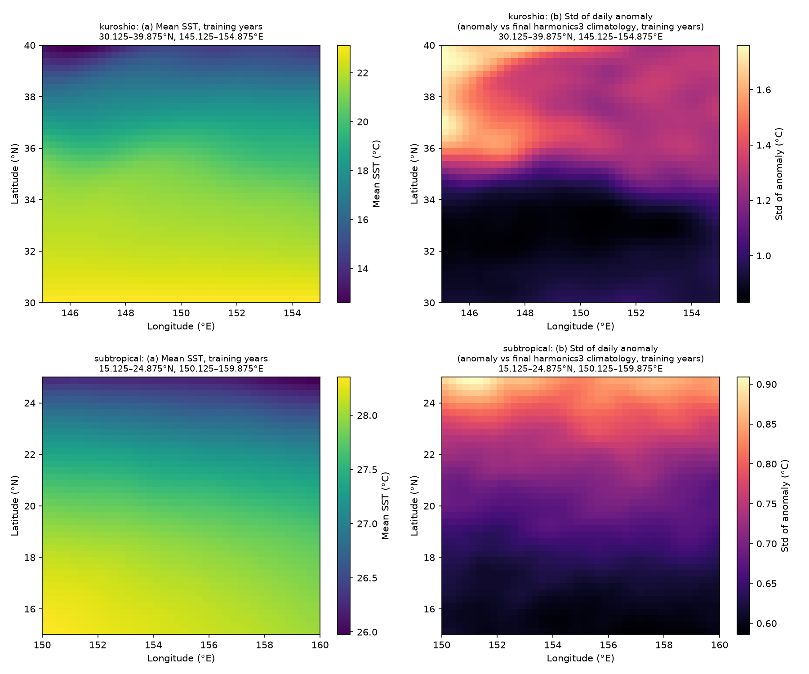
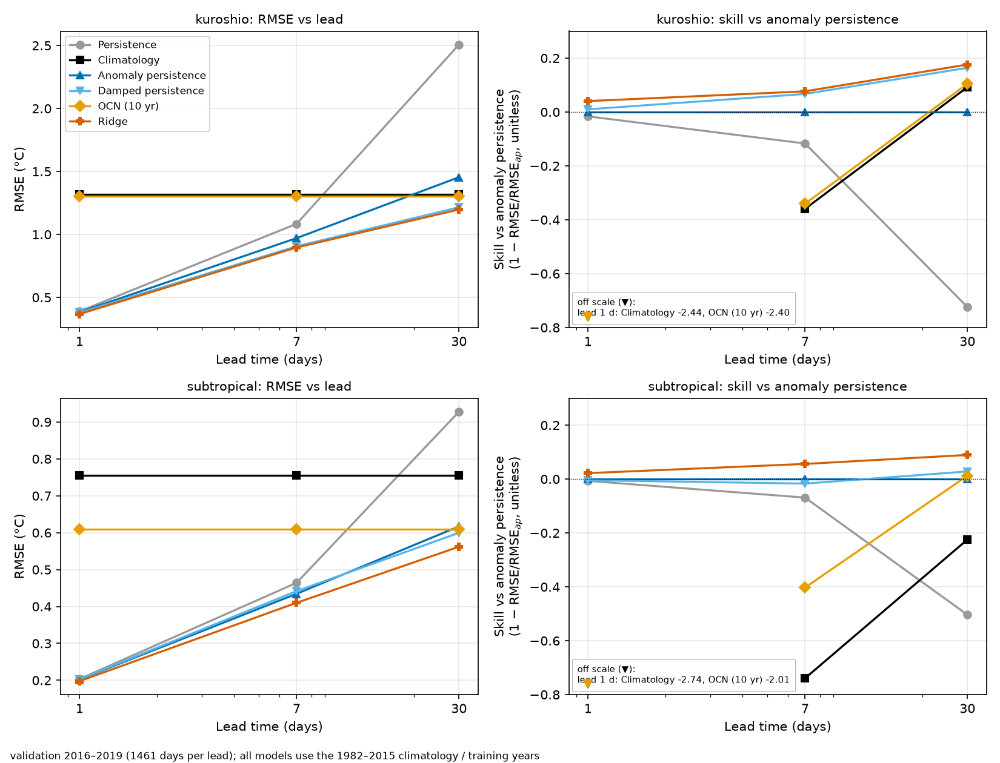
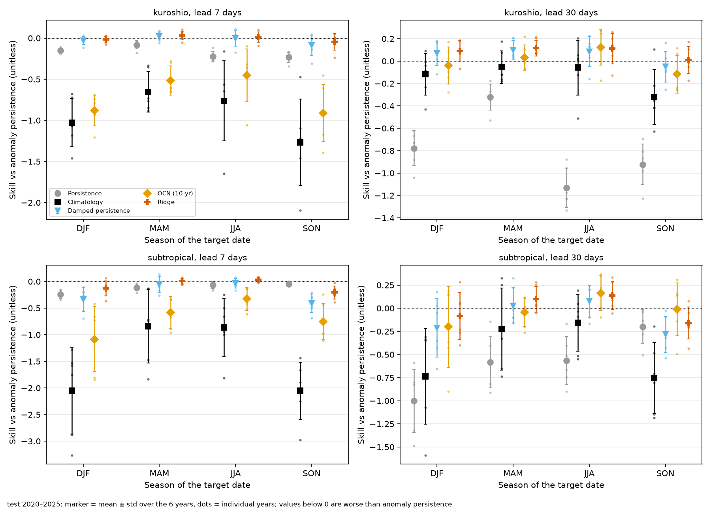
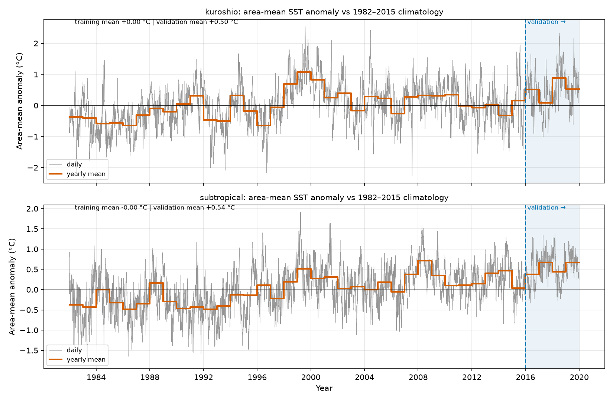
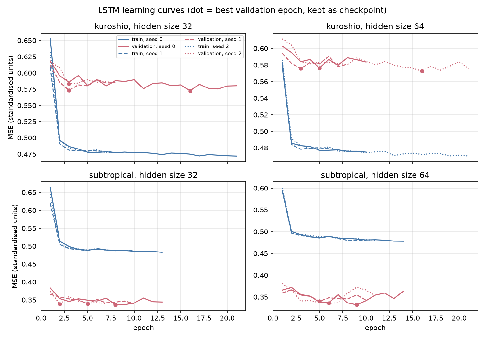

## Задача
Прежде чем сравнивать обучаемые модели для температуры поверхности океана (SST), нужно знать, насколько трудно превзойти простые базовые методы. Проект посвящён именно им. Это не модель прогноза океана. Работа выполнена с разрешения моего преподавателя в HEU.

## Что я сделал
Построил конвейер данных и оценку для ежедневной SST NOAA OISST v2.1 в двух районах Тихого океана (Куросио и субтропический), 1982–2025. В ERDDAP не хватало 1 194 дней на район; я заполнил их из NOAA PSL с проверками. Сравнил шесть базовых методов: персистентность, фиксированная сглаженная климатология, персистентность аномалии, затухающая персистентность, 10-летняя ежедневная климатология (OCN) и Ridge-регрессия для каждой точки сетки. В проекте 40 тестов и CI.

## Методика
Фиксированное разбиение: 1982–2015 — обучение, 2016–2019 — валидация, 2020–2025 — тест. Тест запускался один раз, после того как конфигурация была заморожена и помечена git-тегом.

Позже я добавил небольшой эксперимент с LSTM. Он использует ту же информацию, что и Ridge (последние 30 дней аномалии в одной точке сетки), 1 слой, размер скрытого состояния 64 (выбран на валидации) и 3 запуска на район. Протокол был написан и помечен тегом `pre-lstm-test` до загрузки тестовых лет, тест запущен один раз (2026-11-05). Результаты — среднее по запускам, без выбора лучшего.

## Результаты
Методы, тянущиеся к климатологии (затухающая персистентность и Ridge), потеряли большую часть преимущества, которое имели на валидации, в тестовые годы. Это согласуется с более сильным потеплением в тестовом периоде, но причина не доказана.

> «Хорошая работа.»
>
> — Associate Professor Green, о результатах базовых моделей

Небольшая LSTM превзошла Ridge в субтропическом районе и не превзошла его в районе Куросио. Скилл относительно Ridge на тесте при прогнозе на 1, 7 и 30 дней: субтропики +0,029, +0,025, +0,022; Куросио −0,061, −0,017, −0,001. На валидации значения для Куросио на 7 и 30 дней были слегка положительными, и это преимущество не сохранилось. Субтропический результат слабее, чем выглядит: Ridge там сам уступает персистентности аномалии на 1 и 7 дней, как и LSTM. Два района расходятся, поэтому общих выводов я не делаю.

## Графики
Графики из README репозитория; текст на изображениях на английском.

*Рис. 1. Средняя SST и стандартное отклонение суточной аномалии (годы обучения) в двух районах.*

*Рис. 2 (валидация). RMSE и скилл относительно персистентности аномалии по срокам прогноза.*

*Рис. 2 (тест, 2020–2025). Та же раскладка; значения ниже оси приведены в рамке.*

*Рис. 3. Скилл на тесте относительно персистентности аномалии по сезонам (среднее ± стд. откл. по годам, точки — годы).*

*Рис. S1. Аномалия, усреднённая по району, относительно климатологии 1982–2015; валидационный период закрашен.*

*Кривые обучения LSTM.*

## Ограничения
- Простые базовые методы и один небольшой эксперимент с LSTM, больше ничего обучаемого. LSTM получает полную 30-дневную последовательность и день года, а Ridge — меньше входов, поэтому часть выигрыша LSTM может быть от входов, а не от модели; это не проверялось.
- Два небольших района и один набор данных.

## Участие ИИ
Код написан с помощью Claude Code; методология и проверка результатов — мои.
