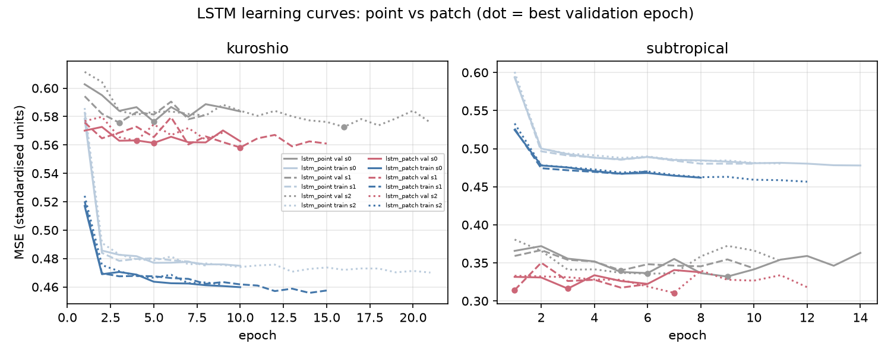
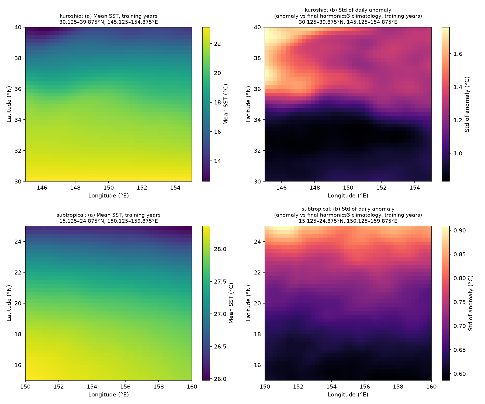
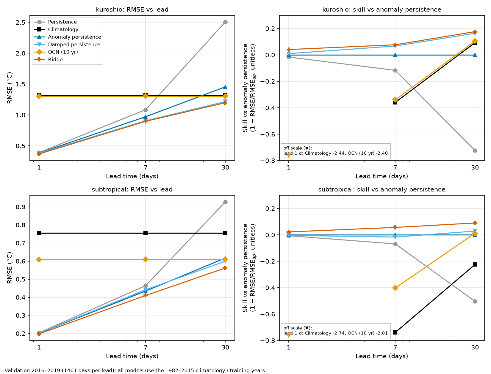
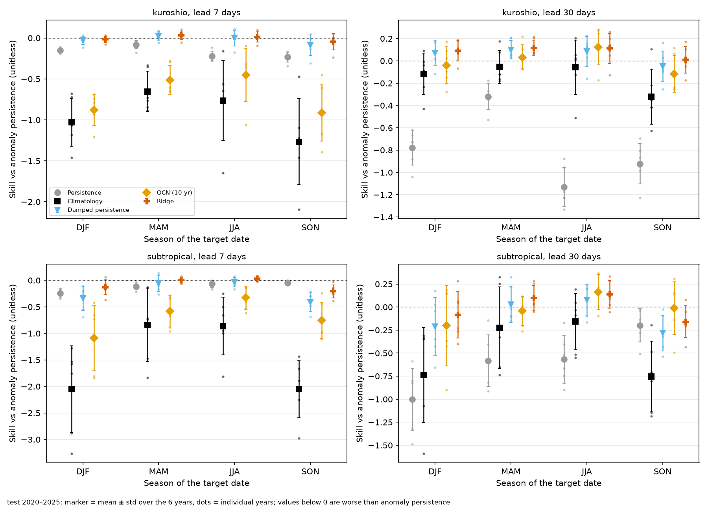
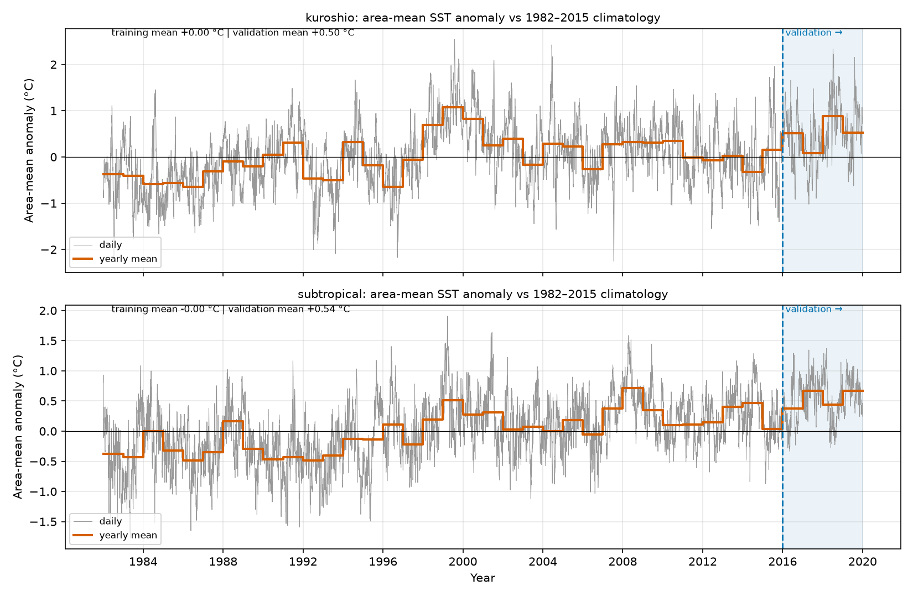
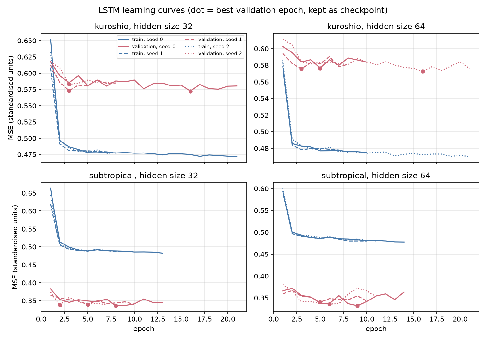

## Muammo
Dengiz sirti harorati (SST) bo‘yicha biror o‘qitiladigan modelni taqqoslashdan oldin, oddiy baselinelardan o‘zib ketish qanchalik qiyinligini bilish kerak. Bu — ana shu baselinelarni o‘rganish, operativ okean prognozi uchun model emas. Ish HEU’dagi o‘qituvchimning ruxsati bilan bajarildi.

## Nima qildim
1982–2025 yillar uchun Tinch okeanining ikki hududida (Kuroshio va subtropik) NOAA OISST v2.1 kunlik SST uchun ma’lumotlar konveyeri va baholashni qurdim. ERDDAP’da har bir hududda 1,194 kun yetishmasdi; ularni tekshiruvlar bilan NOAA PSL’dan to‘ldirdim. Oltita baselineni taqqosladim: persistence, qat’iy tekislangan klimatologiya, anomaliya persistence, so‘nuvchi persistence, 10 yillik kunlik klimatologiya (OCN) va har bir to‘r nuqtasi uchun Ridge regression. Loyihada 107 ta test va CI bor.

## Metod
Qat’iy bo‘linish: 1982–2015 — o‘qitish, 2016–2019 — validatsiya, 2020–2025 — test. Test to‘plami konfiguratsiya muzlatilib, git’da teglanganidan keyin bir marta ishga tushirildi.

Keyin kichik LSTM tajribasini qo‘shdim. U Ridge bilan bir xil ma’lumotdan foydalanadi (bitta to‘r nuqtasida so‘nggi 30 kunlik anomaliya), 1 qatlam va validatsiyada tanlangan 64 hidden size bilan, har bir hudud uchun 3 ta seed bilan. Uning protokoli test yillari yuklanishidan oldin yozilib, `pre-lstm-test` deb teglandi va test bir marta ishga tushirildi (2026-11-05). Natijalar seedlar bo‘yicha o‘rtacha, seed tanlashsiz.

## Natijalar
Klimatologiyaga tortadigan metodlar (so‘nuvchi persistence va Ridge) validatsiyadagi ustunligining ko‘p qismini test yillarida yo‘qotdi. Bu test davrida isish siljishining kattaroq bo‘lishiga mos keladi, ammo sabab isbotlanmagan.

> “Yaxshi ish.”
>
> — Associate Professor Green, baseline natijalari haqida

Kichik LSTM subtropik hududda Ridge’dan o‘zib ketdi, Kuroshio hududida esa o‘zib keta olmadi. Testda Ridge’ga nisbatan skill, 1, 7 va 30 kunlik prognozda: subtropik +0.029, +0.025, +0.022; Kuroshio −0.061, −0.017, −0.001. Validatsiyada Kuroshio uchun 7 va 30 kunlik raqamlar biroz musbat edi va bu yutuqlar saqlanmadi. Subtropik natija ko‘ringanidan zaifroq: u yerda Ridge o‘zi 1 va 7 kunda anomaliya persistence’dan orqada, LSTM ham shunday. Ikki hudud bir-biriga zid, shuning uchun umumiy da’vo qilmayman.

## Fazoviy kontekst (B1)
Keyin qo‘shni to‘r nuqtalari yordam beradimi va LSTM yutug‘ining qanchasi modeldan emas, qo‘shimcha kirishlardan ekanini tekshirdim. Kirish sifatida har bir maqsad nuqtasi atrofidagi 5×5 to‘r nuqtalari patch’i olindi: chiziqli Ridge-patch va kichik LSTM-patch (arxitektura bir xil, 3 ta seed). Hududlar 1° halo bilan kengaytirildi; halo faqat kirishlarni beradi, maqsad va baholash o‘zgarmagan. Protokol test yillaridan foydalanishdan oldin yozilib, `pre-b1-test` deb teglandi va test bir marta ishga tushirildi.

Testda (2020–2025) Ridge-patch Ridge’dan barcha oltita hudud/muddat kombinatsiyasida o‘zib ketdi (Ridge’ga nisbatan skill, 1, 7 va 30 kunda: Kuroshio +0.006, +0.015, +0.020; subtropik +0.038, +0.033, +0.032). Faqat yil kuni Ridge’ga hech narsa bermadi. Subtropik hududda 7 va 30 kunda LSTM-patch Ridge’dan (skill +0.069 ± 0.014 va +0.083 ± 0.004) hamda xuddi shu kirishli Ridge-patch’dan (+0.038 ± 0.015 va +0.053 ± 0.004) o‘zib ketdi. Kuroshio hududida u Ridge-patch’dan o‘zib keta olmadi (−0.190 ± 0.041, −0.022 ± 0.007, 30 kunda esa durang, −0.007 ± 0.010), shuning uchun u yerdagi eng yaxshi model — chiziqli Ridge-patch.

Ogohlantirishlar: subtropik hududda Ridge-patch 1 va 7 kunda hamon anomaliya persistence’dan yomonroq (skill −0.009, −0.014). Validatsiya raqamlari biroz optimistik, chunki yangi alphalar va LSTM’ning erta to‘xtatilishi bir xil validatsiya yillarida tanlangan. LSTM-patch’ning Ridge’ga nisbatan Kuroshio’dagi yutuqlari validatsiyadan testga o‘tganda kamaydi yoki yo‘qoldi. Bir-biriga zid ikki hudud, uchta seed va bitta test ishga tushirish: umumiy da’vo yo‘q; bu o‘rganish tajribasi, okean prognozi modeli emas.

*B1-rasm. LSTM o‘rganish egri chiziqlari, nuqta va patch (validatsiya davri; nuqta — eng yaxshi epoxa).*

## Butun hudud modellari (B2)
**Qisqacha:** test yillarida ikkala butun-hudud modeli ham 7 va 30 kunda ikkala hududda Ridge-patch’dan o‘zib ketdi, eng pasti U-Net; 1 kunda esa ikkalasi ham anomaliya persistence’dan yomonroq edi.

Keyin butun hududni bir vaqtning o‘zida ko‘radigan modellar patch modellaridan o‘zib ketadimi, deb tekshirdim. Bitta model butun 48×48 hududni (30 kunlik anomaliya va yil kunining sin/cos qiymatlari) oladi va ichki 40×40 uchun uchala muddatni birdaniga prognoz qiladi: kichik U-Net (C = 32, 3 ta downsampling, GroupNorm) va ConvLSTM encoder-forecaster (C = 16; hisoblash resurslari tufayli birinchi spetsifikatsiyadan chetlanish, protokolda yozilgan). Har birining residual varianti ham bor (chiqish = oxirgi kirish anomaliyasi + tarmoq). Har bir hudud va model oilasi uchun validatsiyadagi o‘rtacha RMSE eng past bo‘lgan variant testga o‘tdi, tanlovni kod qildi: to‘rttala holatda residual variant. Ular faqat 1982–2015 yillarda (~12 ming namuna) o‘qitildi, erta to‘xtatish 2016–2019 yillarda, har biri 3 ta seed bilan. Protokollar modellar o‘qitilishidan oldin va test yillaridan foydalanishdan oldin yozilib, commit qilindi (teg `pre-b2-test`), 12 ta checkpoint bir marta sinaldi (2026-11-10), og‘irliklar xeshlari manifestlar bilan tekshirildi.

**7 va 30 kunda**, testda (2020–2025), ikkala model ham ikkala hududda Ridge-patch’dan o‘zib ketdi, bunda farq bitta seed std’dan katta (Ridge-patch’ga nisbatan skill: U-Net Kuroshio +0.037 ± 0.006 va +0.049 ± 0.009, subtropik +0.077 ± 0.003 va +0.146 ± 0.020; ConvLSTM-ED Kuroshio +0.028 ± 0.007 va +0.031 ± 0.004, subtropik +0.067 ± 0.014 va +0.128 ± 0.008). Shu bo‘limda taqqoslangan to‘rt model (Ridge-patch, LSTM-patch, U-Net, ConvLSTM-ED) orasida U-Net 7 va 30 kunda ikkala hududda ham eng past test RMSE’ga ega bo‘ldi; masalan, subtropik hududda 30 kunda 0.470 °C, Ridge-patch’da esa 0.550 °C. U-Net oltita hudud/muddat kombinatsiyasining hammasida ConvLSTM-ED’dan past, lekin farq kichik (Kuroshio, 30 kun: 1.194 va 1.217 °C), parametrlar soni esa ~50 baravar ko‘p. Ridge-patch’dan yutuq 7 va 30 kunda subtropik hududda Kuroshio’dagidan kattaroq. LSTM-patch bilan solishtirganda o‘rtachalar barcha 12 ta model/hudud/muddat kombinatsiyasida musbat (U-Net +0.025 dan +0.124 gacha, ConvLSTM-ED +0.010 dan +0.118 gacha); 1 kundagi yutuqning bir qismi shundan iboratki, LSTM-patch testda 1 kunda yomon chiqqan edi (B1).

**1 kunda** esa yo‘q. Ikkala butun-hudud modeli ham Ridge-patch’dan past (U-Net Kuroshio −0.043 ± 0.002, subtropik −0.017 ± 0.019; ConvLSTM-ED −0.050 ± 0.009, −0.032 ± 0.022) va to‘rttala holatda anomaliya persistence’dan ham yomonroq (masalan, U-Net: Kuroshio hududida 0.261 va 0.258 °C, subtropik hududda 0.125 va 0.122 °C).

Validatsiya xulosalari musbat bo‘lgan joyda saqlandi: 7 va 30 kunda Ridge-patch’dan yutuqlar validatsiyada musbat edi va testda kattaroq. 1 kunda subtropik U-Net validatsiyada biroz musbat (+0.014) edi, testda esa manfiy.

Ogohlantirishlar: C, variant va erta to‘xtatish validatsiya yillarida tanlangan. 4×10⁴–2×10⁶ parametr uchun ~12 ming kuchli avtokorrelyatsiyalangan o‘qitish namunasi bor, validatsiyadagi eng yaxshi epoxalar 2–8. Uchta seed faqat o‘qitish shovqinini o‘lchaydi, oltita test yilining tanlanma noaniqligini emas. Residual variant asosan 1 kunlik natijani tuzatadi va 7 hamda 30 kunda deyarli neytral (faqat validatsiya); tanlanmagan variant testda ishga tushirilmagan. O‘rganish tajribasi, okean prognozi modeli emas.

![B2-rasm (xaritalar; validatsiya 2016–2019, test emas). Har bir hudud va model uchun bitta qator (avval Kuroshio, so‘ng subtropik; U-Net C=32, U-Net residual C=32, ConvLSTM C=16, ConvLSTM residual C=16), 0, 1, 2 seedlar bo‘yicha o‘rtacha. Chap va o‘rta ustunlar: 7 va 30 kunlik muddatda 40×40 baholangan nuqta bo‘yicha har bir to‘r nuqtasidagi Ridge-patch’ga nisbatan RMSE skill (1 − RMSE_model / RMSE_Ridge-patch); ko‘k = RMSE Ridge-patch’dan past, qizil = yuqori, oq = teng, rang shkalasi −0.3 dan +0.3 gacha qayd etilgan (rang shkalasi pastda). Qora chiziqlar tashqi 4 nuqtali halqani belgilaydi. O‘ng ustun: xuddi shu skill hudud chetidan teng masofadagi halqalar bo‘yicha o‘rtacha (0 = eng chetdagi nuqta), 7 kun ko‘k, 30 kun qizil, nol chizig‘i bilan.](./figB2_maps_res.png)
*B2-rasm (xaritalar; validatsiya 2016–2019, test emas). Har bir hudud va model uchun bitta qator (avval Kuroshio, so‘ng subtropik; U-Net C=32, U-Net residual C=32, ConvLSTM C=16, ConvLSTM residual C=16), 0, 1, 2 seedlar bo‘yicha o‘rtacha. Chap va o‘rta ustunlar: 7 va 30 kunlik muddatda 40×40 baholangan nuqta bo‘yicha har bir to‘r nuqtasidagi Ridge-patch’ga nisbatan RMSE skill (1 − RMSE_model / RMSE_Ridge-patch); ko‘k = RMSE Ridge-patch’dan past, qizil = yuqori, oq = teng, rang shkalasi −0.3 dan +0.3 gacha qayd etilgan (rang shkalasi pastda). Qora chiziqlar tashqi 4 nuqtali halqani belgilaydi. O‘ng ustun: xuddi shu skill hudud chetidan teng masofadagi halqalar bo‘yicha o‘rtacha (0 = eng chetdagi nuqta), 7 kun ko‘k, 30 kun qizil, nol chizig‘i bilan.*

## Grafiklar
Grafiklar repozitoriy README’sidan; rasmlardagi matn inglizcha.

*1-rasm. Ikki hududda o‘rtacha SST va kunlik anomaliyaning standart og‘ishi (o‘qitish yillari).*

*2-rasm (validatsiya). Prognoz muddati bo‘yicha RMSE va anomaliya persistence’ga nisbatan skill.*

*2-rasm (test, 2020–2025). Joylashuv bir xil; o‘q ostidagi qiymatlar ramkada keltirilgan.*

*3-rasm. Fasllar bo‘yicha testdagi anomaliya persistence’ga nisbatan skill (yillar bo‘yicha o‘rtacha ± std, nuqtalar — yillar).*

*S1-rasm. Hudud bo‘yicha o‘rtacha anomaliya, 1982–2015 klimatologiyasiga nisbatan; validatsiya davri bo‘yalgan.*

*LSTM o‘rganish egri chiziqlari.*

## Cheklovlar
- Oddiy baselinelar, bitta kichik LSTM tajribasi, B1 fazoviy kontekst modellari (Ridge-patch, LSTM-patch) va B2 butun hudud modellari (U-Net, ConvLSTM-ED), boshqa o‘qitiladigan narsa yo‘q. LSTM to‘liq 30 kunlik ketma-ketlik va yil kunini oladi, Ridge esa kamroq kirish oladi, shuning uchun LSTM yutug‘ining bir qismi modeldan emas, kirishlardan bo‘lishi mumkin; bu sinalmagan.
- B1 faqat ikki hududdagi 5×5 patch, uchta seed va bitta test ishga tushirishdan foydalanadi; halo faqat kirishlarni beradi. Ba’zi Ridge alphalar to‘rning pastki chetida turadi (validatsiya egri chizig‘i tekis, o‘zgartirilmagan), validatsiya raqamlari esa biroz optimistik: alphalar va erta to‘xtatish validatsiya yillarida tanlangan.
- B2: butun hudud tarmoqlari uchun ~12 ming o‘qitish namunasi, uchta seed va bitta test ishga tushirish; U-Net/ConvLSTM-ED’ning Ridge-patch’dan 7 va 30 kundagi ustunligi faqat ikki hududdagi oltita test yilida o‘lchangan.
- Ikkita kichik hudud, bitta ma’lumotlar to‘plami.

## AI yordami
Kod Claude Code yordamida yozilgan; metodologiya va tekshiruv menga tegishli.
