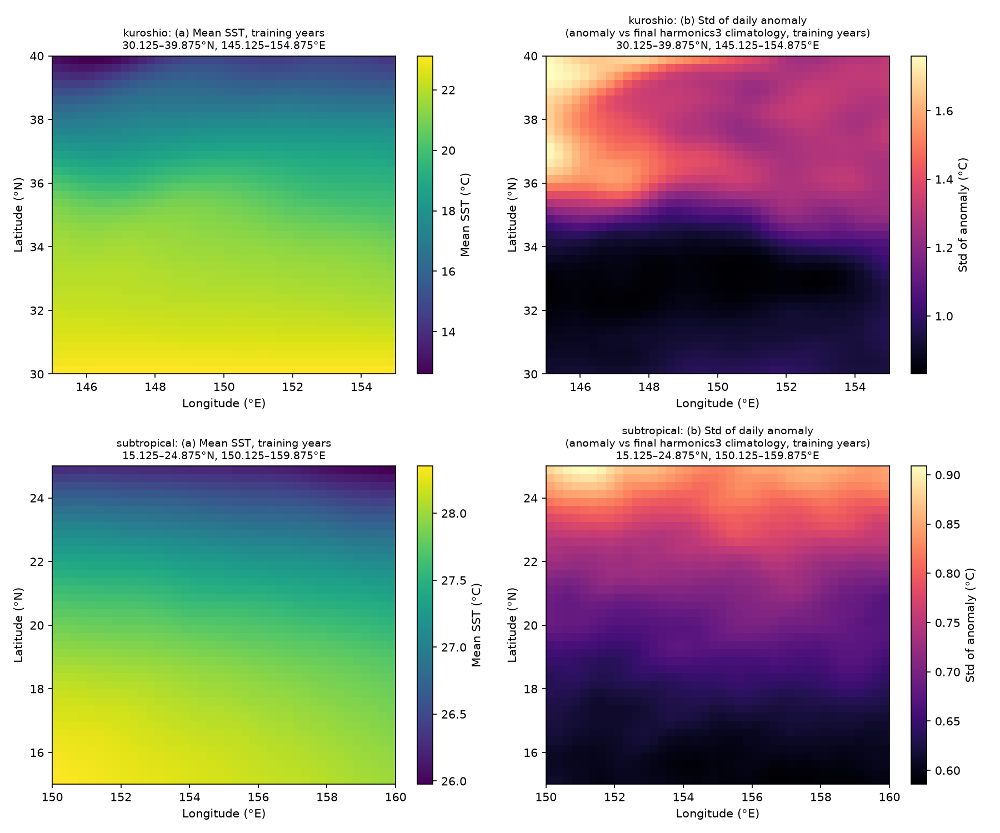
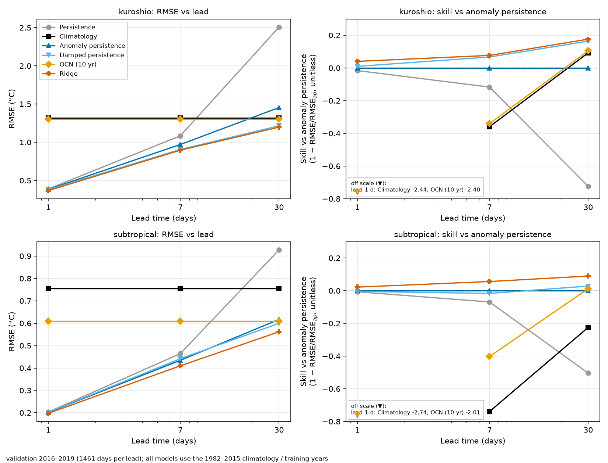
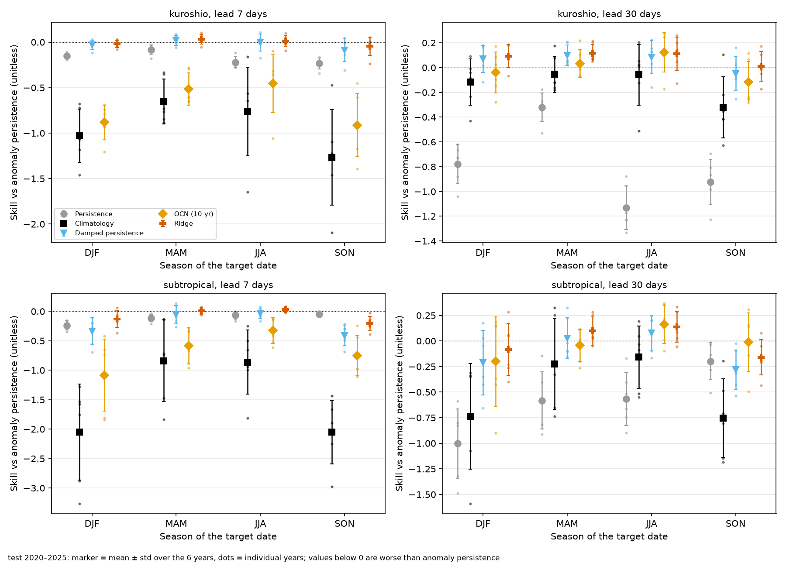
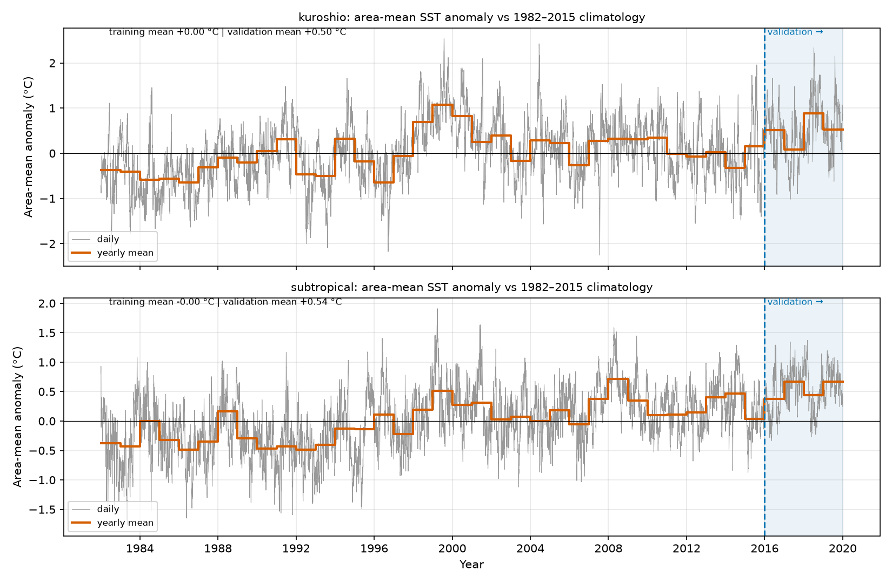
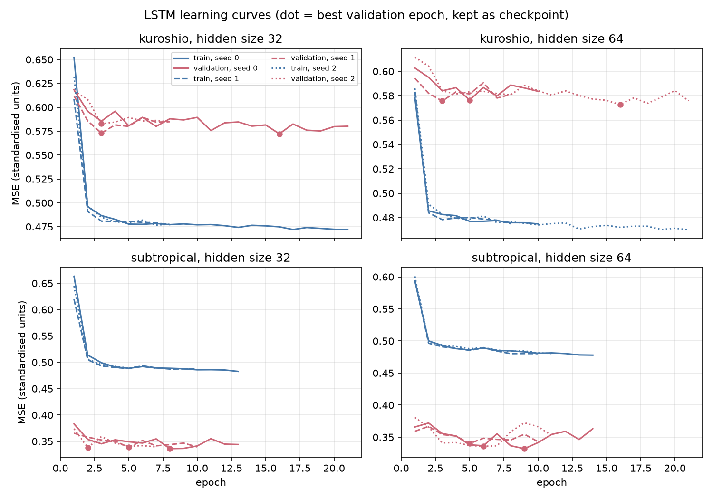

## 问题
在比较任何学习型模型的海表温度（SST）预测之前，需要先知道简单基线有多难被超越。这个项目研究的就是这些基线，它不是海洋预报模型。该工作经哈尔滨工程大学老师许可完成。

## 我做了什么
为两个太平洋区域（黑潮区和副热带区）1982–2025 年的 NOAA OISST v2.1 每日 SST 构建了数据流程与评估。ERDDAP 每个区域缺少 1,194 天，我从 NOAA PSL 补齐并做了验证检查。比较了六个基线：持续性、固定平滑气候态、距平持续性、阻尼持续性、10 年逐日气候态（OCN）以及逐格点岭回归（Ridge）。项目包含 40 个测试和 CI。

## 方法
固定划分：1982–2015 训练，2016–2019 验证，2020–2025 测试。测试集只运行一次，且在配置冻结并打上 git 标签之后。

基线完成后，我又加了一个小型 LSTM 实验。它使用与 Ridge 相同的信息（单个格点最近 30 天的距平），1 层，隐藏单元数 64（在验证集上选定），每个区域 3 个随机种子。其方案在加载测试年份之前就已写好并打上 `pre-lstm-test` 标签，测试只运行了一次（2026-11-05）。结果为各种子的平均值，没有挑选种子。

## 结果
向气候态回归的方法（阻尼持续性和 Ridge）在测试年份中失去了大部分验证期的优势。这与测试期更明显的变暖偏移一致，但原因尚未得到证实。

> “做得好。”
>
> — Associate Professor Green，对基线结果的评语

小型 LSTM 在副热带区超过了 Ridge，在黑潮区没有超过。测试集上相对 Ridge 的技巧评分（提前 1、7、30 天）：副热带区 +0.029、+0.025、+0.022；黑潮区 −0.061、−0.017、−0.001。黑潮区 7 天和 30 天的验证期数值原本略为正，这些优势在测试中没有保持。副热带区的结果比看上去弱：那里 Ridge 在 1 天和 7 天本身就落后于距平持续性，LSTM 也是如此。两个区域的结论不一致，所以我不做一般性结论。

## 图表
以下图表来自仓库 README；图中文字为英文。

*图 1。两个区域训练年份的平均 SST 与逐日距平的标准差。*

*图 2（验证期）。按预报提前期的 RMSE 及相对距平持续性的技巧评分。*

*图 2（测试期，2020–2025）。布局相同；坐标轴下方的数值列在框内。*

*图 3。按季节划分的测试期相对距平持续性的技巧评分（年均值 ± 标准差，圆点 = 各年）。*

*图 S1。区域平均距平相对 1982–2015 气候态；阴影为验证期。*

*LSTM 学习曲线。*

## 局限
- 只有简单基线和一个小型 LSTM 实验，没有其他学习型模型。LSTM 使用完整的 30 天序列和一年中的日期，而 Ridge 的输入较少，因此 LSTM 的部分提升可能来自输入而非模型；这一点未做测试。
- 只有两个小区域和一个数据集。

## AI 辅助说明
代码由 Claude Code 编写；方法设计与结果验证由我本人完成。
